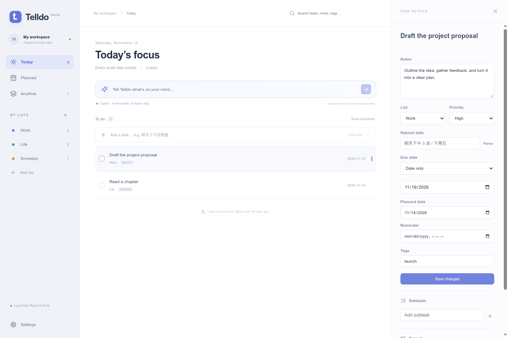
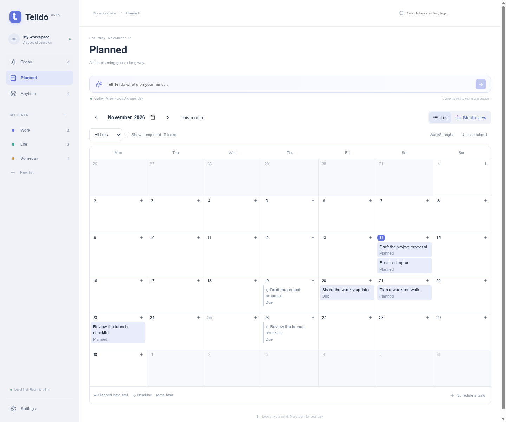

<p align="center">
  
</p>

<h1 align="center">Telldo</h1>
<p align="center"><strong>Say it. Plan it. Get it done.</strong></p>
<p align="center">English · <a href="README.zh-CN.md">简体中文</a></p>

Turn the things on your mind into a plan you can act on. **Telldo is an open-source, local-first desktop task manager** with natural-language capture, calendar planning, and optional AI powered by your own Codex.

**Your task database stays on your computer. Your workflow works without AI.**

[Get started](#get-started) · [How to use](#how-to-use) · [Optional AI](#connect-your-codex-optional) · [Documentation](#documentation)



*Real desktop screenshots with example tasks. Telldo supports English and Simplified Chinese.*

## Why Telldo?

- **Capture at the speed of a thought.** Type a task with a date, or describe what you need in the AI input. Spend less time filling out forms.
- **See the same tasks your way.** Switch between a list and a monthly calendar inside Planned. Keep the same tasks, filters, and details.
- **Separate the plan from the deadline.** Decide when to work on something without moving its due date. Drag to reschedule, then undo a date change if needed.
- **Keep your everyday essentials together.** Lists, subtasks, notes, tags, priorities, recurring tasks, reminders, and search.
- **Keep control of your data and AI.** A local SQLite database, database backups, and JSON import/export. Connect your own Codex locally or over SSH; manual task management works without it.

Free software under the [MIT license](LICENSE). No Telldo account or Telldo AI subscription is required. Your Codex plan, usage limits, and provider charges still apply when you use AI.

## A calendar built around your tasks



A task's main card appears on its planned day, or its due day if it has no planned day. When the two dates differ, a small deadline marker keeps the due date visible. Both open the same task.

Click a day to add a task, drag an unscheduled task onto a date, or move an existing card. Repeating tasks can be moved one occurrence at a time. When a deadline has a reminder, choose whether that reminder follows the move or keeps its original time.

## Get started

### Build the macOS app

You need **Git, Node.js 22.12 or newer, and npm** on a Mac.

```sh
git clone https://github.com/vitslam/telldo.git
cd telldo
npm ci
npm run package:mac
```

Find `Telldo.app` inside the generated `release/` directory, move it to your Applications folder, and open it. For a ZIP package, run `npm run dist:mac` instead.

These development builds are not signed with an Apple Developer certificate or notarized. Platform-specific packaging notes are in the [macOS build guide](docs/macos-packaging.md).

### Run from source

After cloning and installing dependencies:

```sh
npm run dev
```

A desktop graphical session is required. Linux development and Electron tests are supported; Windows has not been verified. See the [current validation record](docs/calendar-acceptance.md) for tested scope. A terminal-only SSH session does not display the desktop app.

## How to use

1. **Capture a task.** Use the add-task field. Try `Send the report tomorrow` or `明天下午3点交周报` (submit the weekly report tomorrow at 3 PM). You can also set dates explicitly in task details.
2. **Choose your focus.** **Today** brings together overdue, due-today, and planned-today tasks. **Planned** shows a selected month as a list or calendar. **Anytime** holds tasks with neither a deadline nor a planned day.
3. **Make a plan.** Open **Planned → Month view**. Adding a task on a date sets its planned day; it does not invent a deadline. Move a planned card without changing its due date.
4. **Keep moving.** Add notes or subtasks, set a repeat rule or reminder, and check tasks off as you finish them.

The interface follows your system language by default. Change language and time zone in **Settings**. Reminders require Telldo to be running, including in the tray; quitting the app stops reminder checks.

## Connect your Codex (optional)

1. Install Codex and sign in on the computer that will run it.
2. In **Settings**, select **This Mac / Local** or **Remote computer over SSH**.
3. Enter the connection details if needed, then choose **Detect Codex**.
4. Use the AI input to turn a request into task changes. Edits are presented for review; a simple single-task addition may apply automatically. Enable **Always confirm AI changes** if you prefer to review every proposal.

SSH runs Codex on the remote computer while the task database stays on your desktop. Follow the [SSH setup guide](docs/ssh-codex.md) for the helper, authentication, and connection options.

**Local storage does not mean local AI inference.** Using AI sends your request and selected task context to your configured Codex provider, and through the remote computer when using SSH. Telldo reuses the CLI login and does not copy its credentials. See [AI behavior and limits](docs/codex-capabilities.md).

## Your data

Use **Settings → Backup database** or **Export JSON** to save a copy of your work. **Open data folder** shows the actual storage location; on macOS the default is `~/Library/Application Support/Telldo/`.

Do not sync the live SQLite database through a cloud-drive folder. Share or back up exported files instead. JSON import creates new IDs and preserves task relationships without overwriting existing tasks. Details: [data and backup model](docs/data-model.md).

## Development

Built with **Electron · React · TypeScript · SQLite**. No external database service is needed.

```sh
npm run typecheck       # TypeScript checks
npm test                # Service and adapter tests
npm run test:smoke      # Desktop task workflow; requires a graphical session
npm run test:calendar   # Desktop calendar workflow; requires a graphical session
```

UI tests use temporary databases, not your everyday tasks. Linux headless setup and packaging instructions are documented below.

## Documentation

| Guide | Covers |
| --- | --- |
| [Dates and reminders](docs/scheduling.md) | Time zones, recurrence, monthly rules, and notification behavior |
| [Calendar design](docs/design/calendar-design.md) | Shared list/calendar semantics and date changes |
| [SSH setup](docs/ssh-codex.md) | Use Codex on another computer |
| [AI behavior](docs/codex-capabilities.md) | Proposals, CLI capabilities, and isolation limits |
| [Data and backups](docs/data-model.md) | SQLite, import/export, transactions, and undo |
| [macOS packaging](docs/macos-packaging.md) | Local builds and Linux cross-packaging |
| [0.2.0 validation](docs/calendar-acceptance.md) | Verified workflows and current platform limits |
| [Original validation](docs/acceptance.md) | Earlier tests and Linux headless setup |

Have a bug report or an idea? [Open an issue](https://github.com/vitslam/telldo/issues). Include what you expected, what happened, and your platform.

[MIT License](LICENSE) · Made for a little less on your mind.
