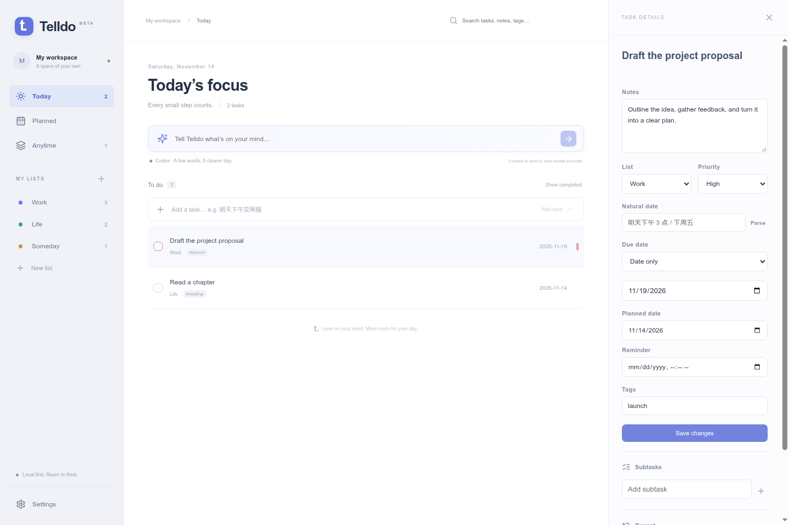
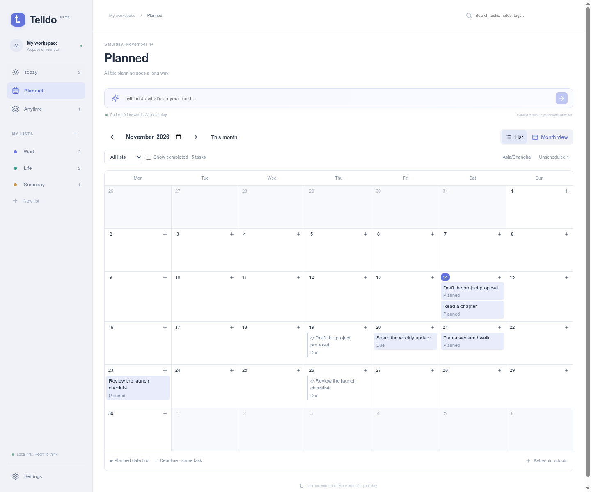

<p align="center">
  
</p>

<h1 align="center">Telldo</h1>
<p align="center"><strong>说出想法，安排到日，一件件完成。</strong></p>
<p align="center"><a href="README.md">English</a> · 简体中文</p>

把脑海里的事情，变成可以行动的计划。**Telldo 是一款开源、本地优先的桌面待办应用**，支持自然语言录入、日历规划，以及由你自己的 Codex 提供的可选 AI 能力。

**任务数据库保存在你的电脑上，不连接 AI 也能正常管理待办。**

[开始使用](#开始使用) · [日常用法](#日常用法) · [连接 AI](#连接你自己的-codex可选) · [更多文档](#更多文档)



*截图来自真实桌面客户端，使用示例任务。应用支持简体中文和英文。*

## 为什么选择 Telldo？

- **想到了，就记下来。** 输入带日期的任务，或在 AI 输入框里描述需求，减少填写表单的步骤。
- **同一批任务，换个角度看。** 在「计划」里切换列表和月历，共享任务、筛选条件和详情。
- **安排归安排，截止归截止。** 决定哪天开始处理，不必跟着修改截止日期。拖动卡片调整日期，改错了还可以撤销。
- **日常需要的功能，一处就够。** 清单、子任务、备注、标签、优先级、重复任务、提醒和搜索。
- **自己掌握数据和 AI。** 本地 SQLite 存储，支持数据库备份及 JSON 导入导出。可以连接本机或 SSH 远端的 Codex；不用 AI，手动功能照常可用。

采用 [MIT 许可证](LICENSE)，免费开源。无需 Telldo 账号，也没有 Telldo AI 订阅。使用 AI 时，仍适用你自己的 Codex 套餐、额度和提供方费用。

## 围绕任务来安排日历



任务主卡片优先放在安排日；没有安排日时，放在截止日。如果两者不同，截止日会保留一个轻量标记。点击任意一处，打开的都是同一个任务。

点击日期新增任务，把待安排任务拖进日历，或移动已有卡片。重复任务可以只改这一次；带提醒的截止日期发生变化时，可以明确选择「提醒跟随」或「保持提醒」。

## 开始使用

### 构建 macOS 应用

在 Mac 上准备 **Git、Node.js 22.12 或更新版本，以及 npm**。

```sh
git clone https://github.com/vitslam/telldo.git
cd telldo
npm ci
npm run package:mac
```

在生成的 `release/` 目录内找到 `Telldo.app`，移到「应用程序」文件夹后打开。需要 ZIP 安装包时，改用 `npm run dist:mac`。

当前开发构建未使用 Apple 开发者证书签名，也未公证。具体打包方式见 [macOS 构建说明](docs/macos-packaging.md)。

### 从源码运行

克隆项目并安装依赖后：

```sh
npm run dev
```

需要桌面图形环境。项目支持 Linux 开发与 Electron 测试，Windows 尚未验证；已验证范围见 [当前验收记录](docs/calendar-acceptance.md)。仅有终端的 SSH 会话无法直接显示桌面窗口。

## 日常用法

1. **记下一件事。** 在添加任务栏输入 `明天下午3点交周报`，即可提取任务和时间；也支持 `Send the report tomorrow`。日期始终可以在详情里手动设置。
2. **选择当前关注点。** 「今天」汇总过期未完成、今天截止和今天安排的任务；「计划」用列表或月历展示所选月份；「随时」收纳既没有截止日期、也没有安排日期的任务。
3. **把任务安排到日。** 打开「计划 → 月历」。点击日期新增只设置安排日，不会自动添加截止期限；拖动安排卡片时，截止日期保持不变。
4. **逐步完成。** 补充备注和子任务，按需设置重复规则或提醒，完成后勾选即可。

界面默认跟随系统语言，可在「设置」中修改语言和时区。提醒需要 Telldo 保持运行，包括托盘后台；完全退出应用后不再检查提醒。

## 连接你自己的 Codex（可选）

1. 在准备运行 Codex 的电脑上安装并登录 Codex。
2. 打开「设置」，选择「本机 Codex」或「通过 SSH 连接远端电脑」。
3. 按需填写连接参数，点击「检测 Codex」。
4. 在 AI 输入框中描述需求。修改操作会展示提案供你确认；简单的单任务创建可能直接应用。如果希望每次都确认，开启「AI 更改一律确认」。

SSH 模式只在远端运行 Codex，任务数据库仍留在桌面客户端所在电脑。助手脚本、认证及连接配置见 [SSH 配置说明](docs/ssh-codex.md)。

**本地存储不代表 AI 推理也在本地。** 使用 AI 时，你的请求和选定任务上下文会发送给所配置的 Codex 提供方；SSH 模式还会经过远端电脑。Telldo 复用 CLI 登录态，不复制其凭证。详见 [AI 能力与限制](docs/codex-capabilities.md)。

## 你的数据

通过「设置 → 备份数据库」或「导出 JSON」保存工作副本。「打开数据目录」可以查看实际存储位置；macOS 默认位于 `~/Library/Application Support/Telldo/`。

不要通过网盘同步正在使用的 SQLite 数据库，可备份或传输导出的文件。JSON 导入会生成新 ID、保留任务关系，不覆盖已有任务。详见 [数据与备份模型](docs/data-model.md)。

## 开发

技术栈：**Electron · React · TypeScript · SQLite**。无需额外部署数据库服务。

```sh
npm run typecheck       # TypeScript 类型检查
npm test                # 服务与适配器测试
npm run test:smoke      # 桌面任务流程，需要图形环境
npm run test:calendar   # 桌面日历流程，需要图形环境
```

界面测试使用临时数据库，不会操作你的日常任务。Linux 无桌面环境的验收方法及打包细节见下方文档。

## 更多文档

| 文档 | 内容 |
| --- | --- |
| [日期与提醒](docs/scheduling.md) | 时区、重复、月末规则和通知行为 |
| [日历设计](docs/design/calendar-design.md) | 列表/月历的共同规则与改期语义 |
| [SSH 配置](docs/ssh-codex.md) | 调用另一台电脑上的 Codex |
| [AI 能力](docs/codex-capabilities.md) | 提案、CLI 能力及隔离边界 |
| [数据与备份](docs/data-model.md) | SQLite、导入导出、事务与撤销 |
| [macOS 打包](docs/macos-packaging.md) | 本机构建及 Linux 交叉打包 |
| [0.2.0 验收](docs/calendar-acceptance.md) | 已验证流程及当前平台限制 |
| [原版验收](docs/acceptance.md) | 历史测试及 Linux 无桌面验收环境 |

发现问题或有新想法？欢迎 [提交 Issue](https://github.com/vitslam/telldo/issues)，说明预期行为、实际结果和使用平台。

[MIT License](LICENSE) · 把想法放下来，把日子过轻一点。
